# SFMC UX Tools

A Chrome extension with usability helpers for Salesforce Marketing Cloud Engagement, and for the content editor of Marketing Cloud Next.

Brought to you by Jörn Berkefeld, the developer behind [SFMC DevTools (mcdev)](https://github.com/Accenture/sfmc-devtools).

> Not affiliated with, endorsed by or supported by Salesforce.

## TL;DR

Install it and Marketing Cloud gets easier to work in. Nothing to set up.

- **Code editors you can read:** AMPscript and SSJS in colour, in a light or dark theme.
- **Help while you type:** suggestions, explanations when you point at code, and mistakes underlined before you save.
- **Tidy code with one click:** the **{ }** button or **Shift+Alt+F**, and **Ctrl+S** saves.
- **Readable keys instead of random ones:** new automations, activities, data extensions, journeys, API events, sender profiles, send classifications, file locations, roles and users get a key made from their name, such as `Welcome_series`.
- **No more "New Journey - 18 November…":** Journey Builder asks you for a real name before a new journey is saved.
- **Transactional SMS, push and OTT messages in a list:** a new entry in the Mobile Studio menu shows them, and lets you create, change and delete them. Marketing Cloud itself has no place for this.
- **Small fixes for everyday annoyances:** select all scopes of an installed package, and a pasted name or key that Marketing Cloud would ignore is used.
- **Private:** nothing is collected and nothing leaves Marketing Cloud.

## Features

Everything below works on its own after installing; there is nothing to set up. A few things can be switched under [Options](#options).

### Where it works

#### Marketing Cloud Engagement

- **Content Builder**: the code view of emails, templates and content blocks, and new content blocks and emails for [readable keys](#readable-keys).
- **Email Studio and CloudPages**: both open Content Builder's code view, so everything said about Content Builder applies there too.
- **CloudPages code resources**: files of one kind, such as JavaScript, CSS, JSON, XML, RSS or text.
- **Automation Studio, script activity**: its code editor gets everything Content Builder's editor gets, unless a section says otherwise.
- **Automation Studio, SQL query activity**: theme and tidying up only. There are no suggestions, explanations or checks for SQL.
- **Automation Studio**: new automations and the dialogs that create an activity, for [readable keys](#readable-keys).
- **Contact Builder and Email Studio**: the dialogs that create a data extension, for readable keys.
- **Email Studio**: the dialog that saves a data filter, for readable keys.
- **Email Studio**: the page that creates a triggered send, for readable keys.
- **Journey Builder**: new journeys and their API events, for readable keys and for [a real name before saving](#journey-builder-a-real-name-before-saving).
- **Setup**: the pages for a new sender profile, send classification, delivery profile, file location, role or user, for readable keys.
- **Read-only editors**, such as the summary step of an activity, get colours, explanations and underlines, but no suggestions and no fixes.
- **Setup → Installed Packages**: the dialog with the list of scopes.
- **The Mobile Studio menu** at the top of Marketing Cloud: the entry for [transactional messages](#transactional-messages-sms-push-and-ott).

#### Marketing Cloud Next

- **CMS content editor**: the code of an email made with **Create with HTML**, and the **HTML** component in emails, landing pages and the content blocks for both.
    - **Explanations for every AMPscript function Marketing Cloud Next has:** point at a function to read what it does, with all its parameters, an example and links.
        - The editor explains 41 functions itself, in one sentence each. While the mouse is on AMPscript, the extension hides that box and shows its own, so you never get two explanations at once. On a Handlebars helper it is the other way round: the editor's box shows and ours does not.
        - 23 functions that came with API version 68 get no explanation from the editor at all. For those, ours is the only one: `Base64Decode`, `Base64Encode`, `BeginImpressionRegion`, `BuildRowSetFromString`, `BuildRowSetFromXML`, `Char`, `ClaimRow`, `ClaimRowValue`, `DatePart`, `Domain`, `EndImpressionRegion`, `GUID`, `IsEmailAddress`, `IsNullDefault`, `LookupOrderedRows`, `LookupRows`, `MD5`, `RegExMatch`, `SHA1`, `SHA256`, `SHA512`, `StringToHex`, `URLEncode`.
    - **Suggestions for every AMPscript function, also the ones the editor leaves out:** while you type a function name inside `%%[ ]%%` or `%%= =%%`, and on **Ctrl+Space** there, the extension suggests all 64 AMPscript functions Marketing Cloud Next has.
        - The editor's own list only opens at the moment you type `%%=` or `%%[`. While it is open, ours stays away.
        - Our list has the extension's icon in its corner.
        - Inside `{{ }}`, **Ctrl+Space** still opens the editor's own list of Handlebars helpers.
        - The editor's own list offers 37 AMPscript functions. These 27 are missing from it; with the extension you get them suggested, explained and with parameter help:
        - `Base64Decode`, `Base64Encode`, `BeginImpressionRegion`, `BuildRowSetFromString`, `BuildRowSetFromXML`, `Char`, `ClaimRow`, `ClaimRowValue`, `ContentBlockByID`, `ContentBlockByKey`, `ContentBlockByName`, `DatePart`, `Domain`, `EndImpressionRegion`, `GUID`, `IsEmailAddress`, `IsNullDefault`, `MD5`, `RaiseError`, `RegExMatch`, `ReplaceList`, `RetrieveSalesforceObjects`, `SHA1`, `SHA256`, `SHA512`, `StringToHex`, `URLEncode`.
        - Counted in the editor of an email content block in November 2026; Salesforce may add to its lists at any time.
    - **Which box is ours:** every box of the extension has its small icon in the top right corner. The editor's own boxes have none.
    - **Parameter help:** while you type a helper or a function, a box lists what it takes.
    - **Checks:** AMPscript that Marketing Cloud Next does not support is underlined, such as a function that only Engagement has, and so is server-side JavaScript. Point at the underline to read why.
    - **Tidying up:** **Shift+Alt+F** formats the code. One **Ctrl+Z** takes it back.
    - **Left to Salesforce:** the colours and everything about Handlebars. The extension explains, suggests and checks no Handlebars helper there, and adds no theme and no formatting on save.

### Colours in the code editor

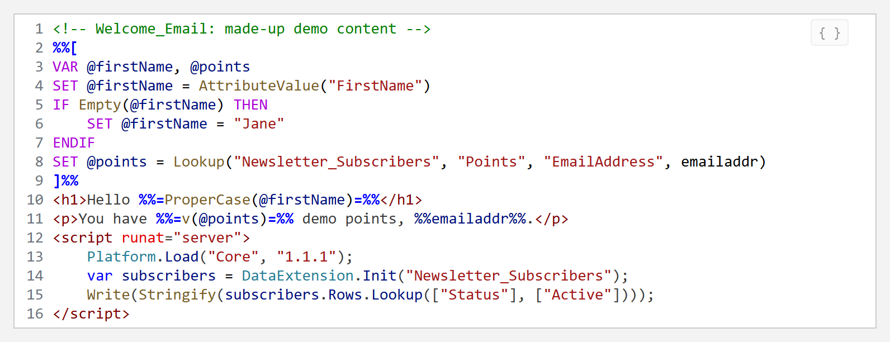

Marketing Cloud colours HTML but shows AMPscript as plain black text. The extension colours it, which makes code much easier to read.

- **AMPscript** gets colours for keywords, functions, variables, texts, numbers and comments. This covers `%%[ ... ]%%` blocks, `%%= ... =%%` expressions and AMPscript inside a script tag.
- **Personalisation strings** such as `%%emailaddr%%` are coloured too.
- **Server-side JavaScript (SSJS)**: Marketing Cloud's own names, such as `Platform`, `DataExtension` and `Write()`, get a colour of their own, so they stand out from ordinary JavaScript.
- **CloudPages code resources**: Marketing Cloud shows them without colours. JavaScript, CSS, JSON, XML and RSS resources are now coloured as what they are, and AMPscript or SSJS inside them is coloured as well.
- **Only the colours change.** Your content stays exactly as you wrote it.
- **One limit:** a script tag is only recognised if its opening tag fits on one line.

### Light and dark theme

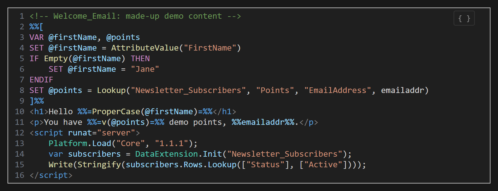

- The editor follows your computer: dark if your computer is in dark mode, light otherwise. It switches along when your computer does.
- You can fix it to **Light Modern** or **Dark Modern** in the options. These are the colour schemes of the code editor Visual Studio Code.
- The theme covers the whole editor: background, line numbers, selection and all code.
- It replaces the themes from Marketing Cloud's own menu.
- The SQL query activity follows the theme too and keeps Marketing Cloud's colours for SQL.

### Suggestions while you type

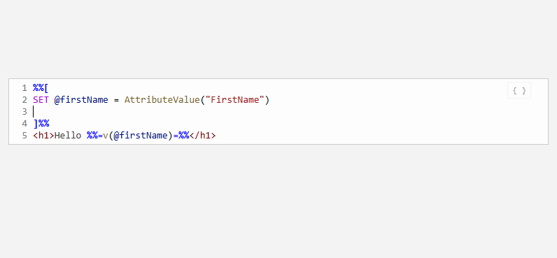

While you type code, a small list offers what fits. Pick an entry and it is written for you.

- **Open the list at any time** with **Ctrl+Space**.
- **AMPscript**: functions, keywords, personalisation strings and the variables you already use in the same content.
- **SSJS**: Marketing Cloud's functions and objects, the JavaScript functions that really work in Marketing Cloud, and the functions you wrote yourself in the same content.
- **Find a function by any part of its name**: `Loo` finds `Platform.Function.Lookup`, and so does `Platform.Function.Loo`.
- **One step at a time**: typing `plat` offers `Platform`; after `Platform.` you see what is inside it, and so on. Upper and lower case do not matter.
- **After a dot**, you get what belongs to the thing in front of it. For example, after a variable that holds a data extension you get `Rows`, and after that `Add`, `Retrieve` and so on.
- **JavaScript for the browser** (any other script tag, and JavaScript code resources of CloudPages): the names used in your browser scripts and the usual JavaScript words. Marketing Cloud's server-side names are kept out, because they do not work there.
- **Picking a function** writes its name and the opening bracket. Nothing is written unless you pick it.
- **In AMPscript**, the list stays away inside texts and comments and in plain HTML.
- **Keys in the list**: the arrow keys move, **Enter** or **Tab** picks, **Esc** closes. In the script activity, **Page Up**, **Page Down**, **Home** and **End** work as well.
- **Not covered yet**: in browser scripts, what belongs to a value, such as the functions of `document`.

### Explanations when you point at code

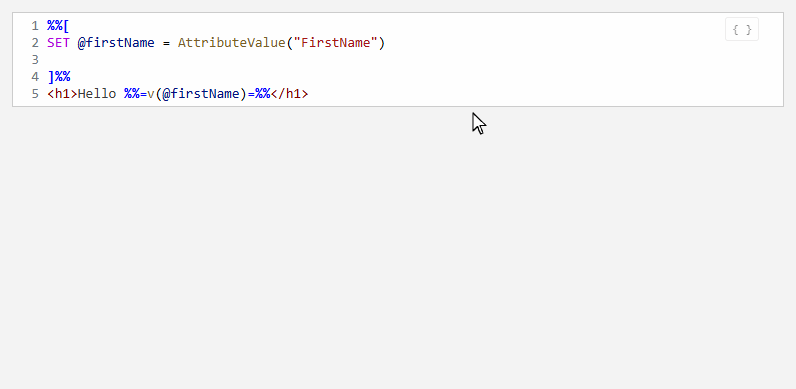

- **Rest the mouse** on an AMPscript function, keyword or variable, or on one of Marketing Cloud's SSJS functions. A box explains what it does, what you have to give it, what you get back, shows an example and links to the full documentation.
- **Your own SSJS code is explained too**: point at one of your variables or functions and the box says what it is.
- **You can move the mouse into the box** to scroll it or click a link.
- Nothing is shown inside browser scripts.

### Help with a function's inputs

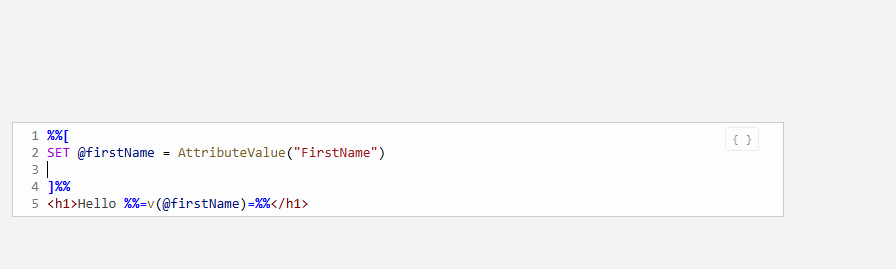

- While your cursor is inside the brackets of a function, a box above the line lists the inputs the function expects and marks the one you are typing.
- It also works when you click into a call that is already written.
- It works for AMPscript functions, Marketing Cloud's SSJS functions and your own SSJS functions.
- **Esc** closes it.

### Mistakes are underlined

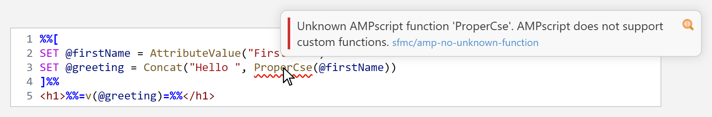

The extension checks your AMPscript and SSJS while you type.

- **Red** means it will not work. **Yellow** is a warning.
- **Rest the mouse on an underline** to read what is wrong, with a link to more information.
- **AMPscript**: unknown functions, too few or too many inputs, blocks and `IF` statements that are never closed, and more.
- **SSJS**: modern JavaScript that Marketing Cloud does not understand (`let`, arrow functions, …), functions Marketing Cloud does not have, a missing `Platform.Load`, and more.
- **SSJS, deeper checks**: mistakes in how you use Marketing Cloud's objects or your own code, such as a misspelt function name (`de.Rowz`).
- **Script activity**: a mark next to the line number shows where a problem is.
- **Fixed in the script activity:** Marketing Cloud's own check marked the `<script runat="server">` tag as an error although it is correct. That false error is gone. **Validate Syntax** still asks Marketing Cloud as before.
- **Not covered**: browser scripts are not checked, and there is no list of all problems yet.

### One-click fixes

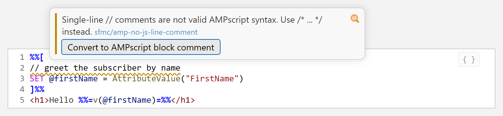

- Where the extension knows a remedy, the box of a problem offers it as a button.
- **Ctrl+.** (**Cmd+.** on a Mac) opens the fixes for the problem at your cursor. **Enter** applies the first one, **Esc** closes the box.
- **Ctrl+Z** undoes a fix in one step.

### Jump to where something is defined

- Hold **Ctrl** (**Cmd** on a Mac) and click a name from your own SSJS code. The cursor jumps to the place where it is defined.
- Works for your functions, variables and the parts of your own objects, within the same content.
- Does not work for Marketing Cloud's own names or for AMPscript.

### Tidy up your code (formatting)

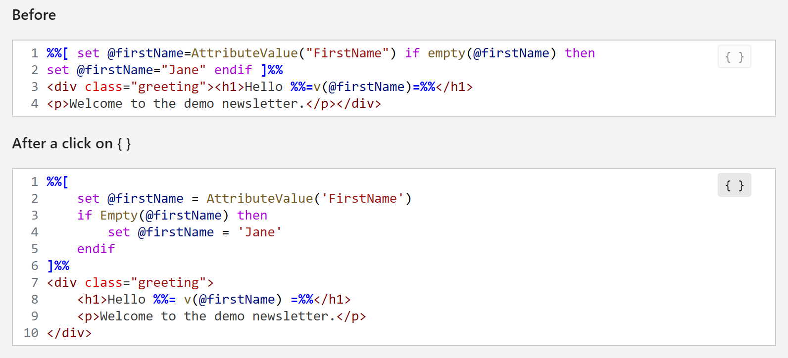

- Click the **{ }** button in the editor's toolbar, or press **Shift+Alt+F**. The whole content is tidied: indentation, line breaks and spacing.
- Covers AMPscript, SSJS, HTML, CSS and browser JavaScript.
- **Ctrl+Z** undoes it in one step.
- **Only the text in the editor changes.** Nothing is saved until you save.
- AMPscript that contains a mistake is left exactly as written; the rest is tidied.
- It always tidies the whole content, not just a selection.
- **Script activity and SQL query activity**: the **{ }** button sits next to **Validate Syntax**. A query is tidied as SQL.
- **CloudPages code resources**: JavaScript, CSS and JSON resources are tidied. A resource that mixes its own code with AMPscript or SSJS is left as it is, so nothing gets rearranged by mistake. XML, RSS and text resources have no **{ }** button.
- **Format on save** (an option, off by default): your code is tidied automatically each time you save. In the script activity and the SQL query activity this happens when you click **Next**. It does not apply to CloudPages code resources, because their Save and Publish buttons sit outside the editor.

### Save with Ctrl+S

- **Ctrl+S** (**Cmd+S** on a Mac) in the code view of Content Builder saves your content, just like Marketing Cloud's **Save** button.
- Without the extension, that key opens the browser's "save this page" window instead.
- Content Builder only: the activities of Automation Studio save at the end of their wizard.

### The browser's right-click menu in the code editor

- A right-click in the code editor opens your browser's normal menu (copy, paste, spell check, …) instead of the menu Marketing Cloud draws over your code.
- The gear button below the editor, which opens that same Marketing Cloud menu, is hidden.
- You can get Marketing Cloud's menu and the gear button back in the options.

### Readable keys

When you create something and leave its **External Key** empty, Marketing Cloud invents a random one such as `77E29FD6-6E4B-42EB-AA34-E4D6F91DCCCD`. With the extension, the key is filled in from the name while you type it: `Welcome series - step 2` becomes `Welcome_series_-_step_2`.

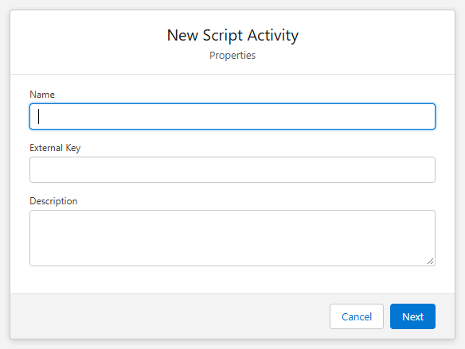

Where it works:

- **Automation Studio**: the dialogs that create an **SQL query**, **script**, **filter**, **import**, **data extract**, **file transfer** or **Contact to Business Unit Mapping** activity.
- **Automation Studio**: a new **automation**. Its key is on the **Summary** tab and in the **Save Automation** dialog, which appears when you save an automation that has no name yet.
- **Contact Builder**: the dialog that creates a **data extension**.
- **Email Studio**: the dialog that creates a **data extension**.
- **Email Studio**: the page that creates a **triggered send** (Interactions → Triggered Emails → Create).
- **Email Studio**: the dialog that saves a new **data filter** (Subscribers → Data Filters → Create, then Save). It is the same dialog for a filter on profile attributes and for one on a data extension. If the dialog answers **Error: Internal server error**, the key is most likely used by another data filter already: change the key and save again.
- **Content Builder**: a new **content block** and a new **email message**. See below.
- **Setup**: the pages that create a **sender profile**, a **send classification**, a **delivery profile**, a **file location**, a **role** or a **user**. A user's key is made from the **username** (the login), not from the person's name, and keeps its dots and its `@`. If a password manager puts a saved login into the External Key field of a new user, the extension replaces it with the key made from the username.
- **Journey Builder**: a new **journey** of any kind (multi-step, single send, transactional), a new **API event**, and the key a **transactional journey** asks for. See below.

In Journey Builder:

- **Journeys have no key field at all.** Journey Builder makes up a random key when you save a new journey, and the key of a journey can never be changed afterwards. With the extension, the journey is saved with a key made from its name instead.
- **You can see and change the key before you save.** The details below the journey's name (Description, Status, Version, …) get a **Key** field. It opens by itself for a new journey, shows the key made from the name, and follows the name while you type. Type your own key there if you want another one.

    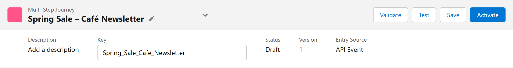

- **You can read the key of a saved journey.** Once the journey is saved, the same place shows its key as text. Click it to mark the whole key, then copy it. Open the details with the small arrow next to the journey's name. This also works with readable keys switched off.
- **API events show their key but do not let you change it.** With the extension, the **Event Definition Key** of a new API event is a field you can type in, with the same look as the **Activity Name** field next to it. It starts with a key made from the event's name.
- **Transactional journeys ask for an Event Definition Key.** The extension fills it in from the journey's name. You can change it before you save.
- **A key that is already used gets a number.** If another journey or event already has the key, yours gets `_2`, `_3` and so on. This matters: Marketing Cloud does not refuse a second journey with the same key, it quietly turns it into a new version of the first one.
- **Journeys and events that already exist are never touched**, and neither is a new version of a journey.
- **Other kinds of entry events** (data extension, CloudPages, Salesforce data, …) keep the key Journey Builder gives them.

In Content Builder:

- **Content blocks ask for a name when you save them the first time.** That dialog has a **Customer Key** field, which the extension fills from the name while you type.
- **Email messages have no key field.** Marketing Cloud gives a new email a random key. With the extension, the email is saved with a key made from its name instead. This covers all three kinds: HTML, template-based and text only.
- **A key that is already used gets a number.** Marketing Cloud refuses a second piece of content with the same key. So if the key is taken, yours gets `_2`, `_3` and so on, for emails and for blocks whose key came from the name.
- **A key you typed yourself for a block is sent as you typed it.** If it is taken, Marketing Cloud tells you.
- **Keys of content are at most 36 characters long**, so a long name is cut.
- **Emails and blocks that already exist are never touched.**
- **Everything else you can create there** (templates, images, uploads, mobile and chat messages) keeps the key Marketing Cloud gives it.

How the key is built:

- Spaces become underscores.
- Accents are removed: `ö` becomes `o`.
- Only the letters A to Z, digits, underscores and hyphens are kept. Everything else, including dots, is left out. The one exception is the key of a new user, which keeps dots and `@`.
- The key is shortened to the length the field allows.
- A name with none of these characters, for example one in Japanese, gives no key. Marketing Cloud then uses a random one, as before.

Good to know:

- **Your own key wins.** As soon as you type a key yourself, the extension leaves it alone. Empty the field and it follows the name again.
- **Only for new things.** If a dialog opens with a key, because you are editing something that exists, that key is never changed. A new automation's key follows its name only until the automation is saved.
- **Nothing is saved for you.** The extension only fills the field, or in Journey Builder the key that is sent when you save. In the dialogs, Marketing Cloud tells you when you finish if the key is already in use.
- **Longer keys for data extensions:** Contact Builder's dialog stops the key at 36 characters, although Marketing Cloud accepts 200. The extension lets you use all 200.
- You can switch readable keys off in the options.

### Journey Builder: a real name before saving

Every new journey starts with a name like "New Journey - 18 November 2026 at 11.03". It is easy to save it that way by accident, and the name is also handed on to the journey's API event.

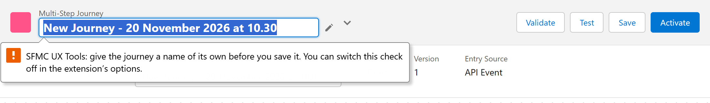

- **Save is held back** while the journey still has that made-up name. The name field opens with the old name selected, so you can type the new one right away.
- This applies to **Save**, **Validate**, **Test** and **Activate**.
- As soon as the journey has a name of its own, saving works as usual.
- Journeys that already exist are not affected.
- You can switch this check off in the options.

### Fixed: pasting a name or key with the mouse

In Contact Builder's dialog for a new data extension, Marketing Cloud ignores text that you paste with the mouse (right-click → **Paste**) or drag into the field. The field shows your text, but it is not used.

- **Pasted key:** without the extension, your data extension gets a random key instead of the one you pasted. With the extension, your key is used.
- **Pasted name:** the same fix applies to the name field.
- **Always on.** This fix has no switch and also works when readable keys are switched off.
- Pasting with **Ctrl+V** was never affected.

### Fixed: an automation's name is kept when you click Save

In Automation Studio you name a new automation in the small field at the top left. That field has its own **Done** and **Cancel** buttons.

- **Without the extension:** if you type a name and click anywhere else, for example on **Save**, Marketing Cloud throws the name away. The "Save Automation" window then tells you that the automation has no name.
- **With the extension:** a click anywhere else keeps the name you typed, as if you had clicked **Done** first.
- **Cancel** still drops what you typed.
- **Always on.** This fix has no switch.

### Fixed: no saved logins in a new user

When you create or edit a user under **Setup → Users**, the page has a username and password fields. A browser's password manager takes that for a login form.

- **Without the extension:** the browser fills one of your saved logins into the **Username**, the **External Key** and the **Temporary Password** of the user you are creating. If you do not notice, the new user is saved with someone else's details.
- **With the extension:** the browser is told that these are not login fields, so it leaves them empty.
- Chrome still shows its list of saved logins when you click into **Temporary Password** or **Confirm Password**; the extension cannot switch that list off. If you pick an entry from it by mistake, the extension takes out again what Chrome fills in. What you type there yourself stays.
- Password managers that are extensions (LastPass, 1Password, Bitwarden, Dashlane) are told to skip these fields too.
- LastPass pastes a saved login into the **Username** anyway when you click into it. The extension takes it out again at once; what you typed or pasted yourself stays.
- If a password manager writes a saved login into the **External Key** anyway, the extension puts back the key made from the username. A key you typed yourself stays.
- You can switch this off in the options, under **Saved logins on Setup's user pages**.

### Select all scopes of an installed package

When you add or edit an API integration under **Setup → Platform Tools → Apps → Installed Packages**, the dialog lists around a hundred checkboxes.

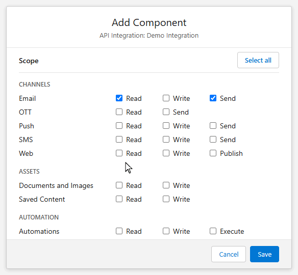

- A **Select all** button in the **Scope** bar ticks every scope, including the ones scrolled out of view.
- Once everything is ticked, the button turns into **Deselect all**.
- Nothing is saved until you press the dialog's own **Save** button.
- Works in every language of Marketing Cloud, when adding a component and when editing one.

### Transactional messages: SMS, push and OTT

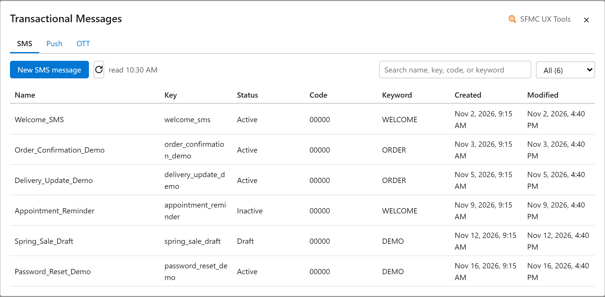

Marketing Cloud can send transactional SMS, push and OTT messages (OTT covers WhatsApp and similar channels). They are set up through the API only: no app of Marketing Cloud shows which ones exist. The extension adds a place to see, create, change and delete them.

The folder names of contents, the texts of a push content, the list for personalization and saving custom keys were seen answering on a real account. They were tried with the same requests the panel sends, not by clicking through the panel itself.

- **A new entry in the menu:** point at **Mobile Studio** at the top of Marketing Cloud. Below MobileConnect, MobilePush and GroupConnect you find **Transactional Messages**. The small icon behind it is this extension's, to show who added the entry.
- **A list per channel:** the panel that opens has the tabs **SMS**, **Push** and **OTT**. Each lists the messages of the business unit you are in.
    - **Columns:** name, key, status, and the dates a message was created and last changed, in your local date and time. SMS also shows **Code** and **Keyword**, push shows **App** and **Content** by their names.
    - **Search:** type into the search box to filter by name, key and the channel columns.
    - **Show by status:** the list next to the search box shows only the messages of one status.
        - It offers **All** and every status that occurs in the list, each with its number, such as "All (249)", "Active (237)", "Inactive (1)", "Draft (11)".
        - It works together with search, sorting and the pages.
        - Your choice is kept per tab, also when you open a message and come back or reopen the panel.
        - The numbers are counted again when the list is read again. If no message has the chosen status any more, the list shows all.
    - **Sorting:** click a column heading; click again to turn the order round.
    - **Pages:** 50 messages per page, with **Previous** and **Next**.
    - **Only the rows scroll.** The column headings, the bar above the list and the page buttons below it stay in place.
    - **Long lists are read completely.** The panel reads 100 messages per request until Marketing Cloud has no more.
- **The list is kept, not read again and again:** switching tabs, coming back from a message and reopening the panel show the list from memory.
    - It is read again after you created, changed or deleted a message in the panel, when you click the **Refresh** button, and after you reload the page.
    - **Refresh** is the button with the reload sign next to **New … message**. Point at it to read its name.
    - A note beside it says when the list was read, such as "read 14:05".
    - It is also dropped when you change the business unit.
- **Code, keyword, app and content come a moment later:** Marketing Cloud's list does not contain them, so the panel reads each message once in the background, a few at a time, and says how far it is ("details 120 of 312").
    - What was read is kept for as long as the page is open. After a refresh, only messages that are new or were changed are read again.
    - Until all are read, sorting by these columns is switched off, and a search finds them only in the messages already read.
    - On the first opening of a list with several hundred messages, that many requests go out once.
- **The details of one message:** click a row to see everything Marketing Cloud stores for it, with plain labels such as **Key**, **Message** or **Code**. Point at a label to see the name of the field in the API. **← All … messages** takes you back.
    - **Names first:** for a push message, the name of its app and of its content comes first, and the ID or key after it in small grey letters. The same goes for the content of an OTT message. If the name is not known, only the ID or key is shown.
    - **The text of an SMS is shown in the code editor**, as in the form, but only to read:
        - It has the same colours, and explains a function when you point at it.
        - You can mark and copy the text. You cannot change it there; use **Edit** for that.
        - It is as tall as the text, up to a limit; a longer text scrolls.
        - If the editor cannot be loaded, the text is shown as plain text, as before.

    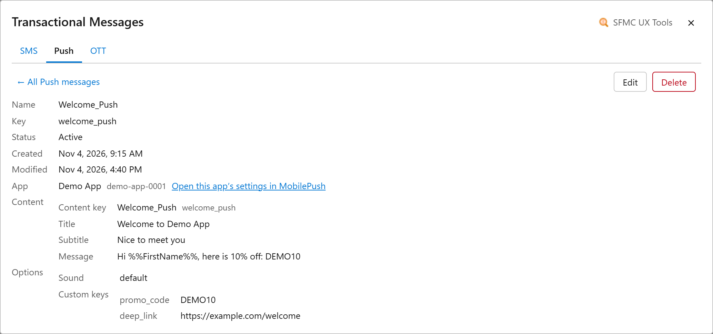

    - **What a push message says:** under the content key, the details show the **Title**, **Subtitle** and **Message** of the chosen content, read from Content Builder. They are shown as they are written there, AMPscript included, and cannot be changed here. A text that is empty is left out; if the content cannot be read, the lines are simply missing.
    - **Custom keys of a push message** are listed by their name, each with its value.
    - **A warning for custom keys the app no longer has:** if a push message holds custom keys that its app does not define, a warning box at the top names them and says that saving the message here removes them. The keys are marked in the list below it.
        - The **Push** list shows a warning sign in the **App** column of such a message. Point at it to read the keys.
        - Nothing is marked when the list of apps cannot be read or does not have the app.
    - **Open this app's settings in MobilePush:** a link next to the app of a push message opens the screen where the custom keys of that app are set up, in a new tab.
    - **Open this code in MobileConnect:** a link next to the code of an SMS message opens that code in a new tab. It is shown once the list of codes is read and has the code.
- **Create a message:** every list has a **New … message** button. It opens a form with the fields of that channel:
    - **SMS:** name, key, description, status, the text of the message, the code and keyword it is sent with, the country code of a short code, and whether the recipient is added or updated as a subscriber.
    - **Push:** name, key, description, status, the app, the custom keys of that app, the content (the customer key of the push message in Content Builder), sound and badge.
    - **OTT:** name, key, description, status, the sender (WhatsApp and its phone number) and the content.
    - **No saved logins in these forms:** the fields have names that password managers do not take for a login or a person's name, and the browser is asked not to fill them in.
- **The text of an SMS is written in a code editor**, like the code view of Content Builder:

    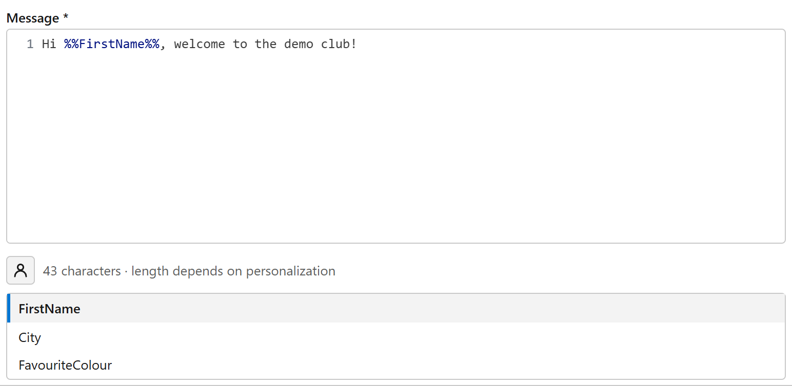

    - **Colours** for AMPscript and personalisation strings, in the light or dark theme chosen in the options.
    - **Suggestions** while you type and on **Ctrl+Space**, **explanations** when you point at a function, **help with a function's inputs**, and **underlined mistakes**.
    - **Keys:** **Tab** moves on to the next field. **Esc** closes an open list of suggestions and leaves the form open. **Ctrl+S** does nothing here; the message is saved with the button of the form.
    - There is no formatting (**Shift+Alt+F**) in this editor.
    - If the editor cannot be loaded, the plain text field stays and works as before.
    - The forms for push and OTT have no such field and are unchanged.
- **Helpers below the text of an SMS:**
    - **Insert personalization:** the button with the person sign opens a list of the attributes your business unit added to **MobileConnect Demographics**. Choose one and `%%Name%%` is put in at the cursor.
        - **Keys:** the arrow keys move through the list, **Enter** or **Space** takes the marked attribute, **Esc** closes the list and leaves the form open.
        - If the business unit has no such attributes, or they cannot be read, the button is not shown.
    - **Length:** a line says how many characters the message has, such as "42 characters".
        - Characters from the extension table of the GSM alphabet, such as `€` or `[`, count as two.
        - Characters that are not in the GSM alphabet, such as emoji or typographic quotes, are counted separately: "3 not in the GSM alphabet".
        - If the message contains `%%`, the line adds "length depends on personalization".
        - The panel does not say how many SMS parts a message needs or what it costs.
    - **Show non-GSM characters:** this button marks those characters in the code editor. The marks go away as soon as you change the message; click again to see them again.
        - The button is shown only when the message has such characters, and only with the code editor.
    - Both helpers also work with the plain text field, except for the marks.
    - A message that cannot be changed in the form has no helpers.
- **The key follows the name** while you type, as with [readable keys](#readable-keys) elsewhere, until you type a key yourself. The **Readable keys** option switches this off.
- **SMS code and keyword are two lists:** choose the code first; the keyword list then shows only the keywords of that code. A code reads like `8850 · NL · short code · SHARED`.
    - Both lists are in alphabetical order, the same every time.
    - If Marketing Cloud's lists cannot be read, both are plain text fields.
    - When you edit a message whose code or keyword is not in the lists, it stays chosen and is marked as not found.
    - The lists show what Marketing Cloud returns in its first answer, which is up to 50 codes and 50 keywords.
    - **Add a keyword on the way:** below the keyword list, **Open this code in MobileConnect** opens the chosen code in a new tab. Add a keyword there, then click **Reload keywords** (the button with the reload sign).
        - Reloading reads the codes and keywords again and keeps what you chose. It sends nothing and does not count as a change.
        - If they cannot be read, the lists stay as they were and a line says so.
- **App and content of a push message are chosen from a list** that opens below the field:
    - **The field shows the name**, and a small line below it shows the ID or key. The ID or key is what is sent, as before.
    - **It opens on every click** into the field, also when the field already holds something, and shows all entries.
    - **Every entry is shown in full length:** its name and, beside it, its ID or key. A long one continues on the next line.
    - **Type to narrow it down:** the list keeps the entries whose name or ID contains what you typed.
    - **Keys:** the arrow keys move through the list, **Enter** takes the marked entry, **Esc** closes the list and leaves the form open.
    - **What you type counts like this:**
        - An ID or key that is in the list stands for that entry. When you leave the field, it shows the name.
        - A full name that exactly one entry has stands for that entry, in any upper or lower case.
        - Anything else is sent exactly as you typed it, also a name that two entries share. The line below then says "not in the list – sent as typed".
    - **The field still takes any ID or key you type**, also one that is not in the list.
    - **A message whose ID or key is not in the list keeps it:** the field shows the ID or key itself, and nothing is sent unless you change it.
    - **App:** the list has the apps of the business unit, sorted by name.

        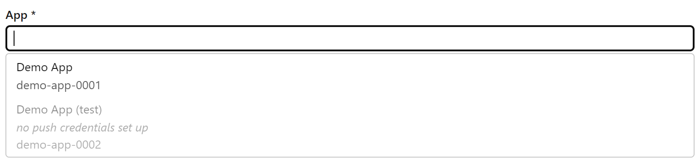

        - **An app without push credentials is greyed out** and says "no push credentials set up". It cannot be chosen, with the mouse or with the keys. These are the apps that MobilePush greys out too: apps with neither Android credentials nor a working iOS key or certificate.
        - **The app a message already has stays.** When you edit a message whose app has no credentials, that app is still chosen, can be kept and can be chosen again.
        - **A typed or pasted ID of such an app is refused:** a line under the field says why, and the form is not sent until you choose another app.
        - If the panel cannot find out which apps have credentials, no app is greyed out or refused.
    - **Content:** the list has the push messages of Content Builder, sorted by name. Choosing one fills in its customer key.

        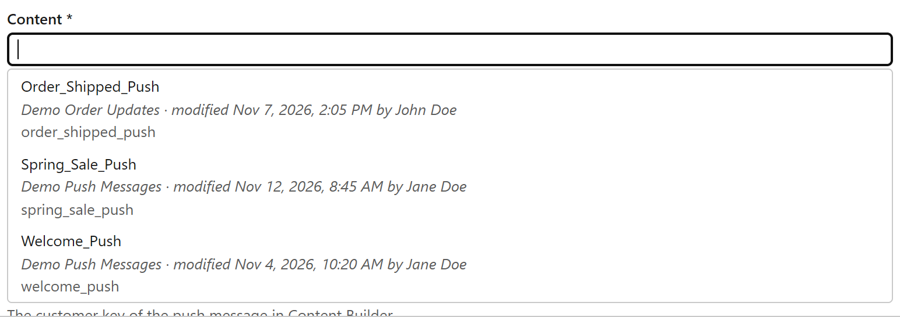

        - Every entry also names its **folder**, **when it was last changed** (in your local date and time) and **by whom**.
        - Typing the name of a folder keeps the messages in that folder.
        - If the folders cannot be read, the entries are shown without them.
        - Messages written for SMS or for in-app are left out: on an account with push messages, every transactional one held a message written for push.
    - If Marketing Cloud's list cannot be read, the field is a plain text field that shows and takes the ID or key.
- **The content of an OTT message is chosen from a list too**, which works like the one of push: name in the field, customer key below it, folder, date and author in each entry, and any typed key is still taken.
    - **Which messages it offers:** the mobile messages of Content Builder that are written for something other than push, SMS or in-app. Each entry says what it is written for.
    - **Why not "WhatsApp messages":** we do not know how Content Builder marks a WhatsApp message. On a real account we only saw messages for push, SMS and in-app.
    - **Not verified:** that the content of an OTT message is a mobile message of Content Builder at all is an assumption.
    - If there is no such message, the list says so, and you type the customer key.
    - The texts of the content, custom keys and the check for push credentials belong to push only.
    - **Sender ID stays a plain field.** Marketing Cloud's list of WhatsApp senders was empty on our account, so we do not know what an entry looks like and built nothing on a guess.
- **Custom keys of a push message:** below the **App** field, the form has one text field for every custom key of the app you chose.
    - Marketing Cloud only accepts custom keys that the chosen app defines.
    - Choose another app and the fields change to the keys of that app. An app without custom keys has none.
    - A key you leave empty is not sent.
    - You never type the name of a key, only its value.
    - When you edit a message, the keys it already has are shown at once.
    - **Keys the app no longer has:** a message can still hold a key that was removed from its app later. Marketing Cloud refuses to save such a message.
        - These keys are not fields. A red box lists them with their values and says they will be removed when you save the message.
        - Saving removes them, also when you changed nothing else.
        - The box has a link **Open this app's settings in MobilePush**. It opens in a new tab, so the form stays open. Add the key to the app there if you want to keep it.
        - Right before saving, the panel reads the list of apps again. If the keys of the app changed meanwhile, nothing is saved and the form shows the new state: check it and save again. If the list cannot be read, nothing is saved either.
        - Choose another app and the same box lists the keys that app does not have. Choose an app that has them and they are back as they were.
        - If the list of apps cannot be read, or the app is not in it, nothing is removed: all keys are sent back as they are stored.
    - Empty a key that had a value and it is taken out of the message.
    - Changing one custom key sends the whole list of custom keys, together with the other options of the message.
- **What Marketing Cloud refuses is shown:** if a message cannot be created, the form says why in Marketing Cloud's words and keeps what you typed.
- **A new message starts as Active** unless you choose another status in the form. An active message can be sent at once by anything that knows its key.
    - **Push has three statuses:** Active, Inactive and Draft. Marketing Cloud stores a new push message as Draft unless it is Active, also when you choose Inactive.
- **Links in an SMS:** two optional boxes switch on Marketing Cloud's link shortening and its tracking of the shortened links per subscriber.

    

    - **Switched off for the account:** if your account has "Salesforce Link Shortening and Tracking" switched off in MobileConnect's setup, the two boxes cannot be ticked, and a line below them says so.
    - **Setup > MobileConnect** in that line is a link. It opens MobileConnect's administration in a new tab, so the form stays open.
    - A box that is already ticked on a message stays usable, so that you can untick it.
    - A box that cannot be ticked changes nothing in what is sent.
- **Send blockout window:** if your account has a send blockout window in MobileConnect's setup, the SMS form says above the message that messages may be held back during it, with the same link to MobileConnect's administration. There is nothing to fill in.
- **Where this comes from:** the panel reads the MobileConnect settings of the account once, when an SMS form opens, and again after **Refresh**. If they cannot be read, the form is as it would be without them.
- **Change a message:** the details have an **Edit** button. It opens the same form, filled in. The key cannot be changed.
    - Only what you changed is sent. If you change nothing, nothing is sent.
    - Right before saving, the panel reads the message again. If someone changed it meanwhile, or you changed the business unit in another browser tab, nothing is saved and the form says so.
    - After saving, the panel reads the message once more and compares it with what you sent. If Marketing Cloud answered "saved" but holds something else, the panel names the fields that differ.
- **Delete a message:** the details have a **Delete** button. The panel then asks once more, with the name, key and status of the message, and only **Delete it** deletes. Marketing Cloud cannot bring a deleted message back, and whatever still sends with its key will fail.
- **A safeguard against the wrong business unit:** right before deleting, the panel reads the message again. If it is no longer the one on screen, for example because you changed the business unit in another browser tab, nothing is deleted.
- **Creating, changing and deleting were tried on real messages:** on a business unit with SMS and push, a test message of each kind was created, changed and deleted through the panel, and nothing else on that business unit changed. OTT could not be tried, see the last point.
- **What Marketing Cloud does with a deleted message:** it keeps it, marked as deleted, and replaces its key and name with a random ID, so the key is free again. The panel leaves deleted messages out.
- **Always marked as ours:** the panel shows the icon and **SFMC UX Tools** at its top, so nobody takes it for a part of Marketing Cloud.
- **OTT is untested:** it was built from Salesforce's documentation, because we have no account with WhatsApp or a similar channel. If you have one, please tell us whether it works, in the [issues on GitHub](https://github.com/JoernBerkefeld/chrome-sfmc-ux-tools/issues). The tab says so too.

### Options

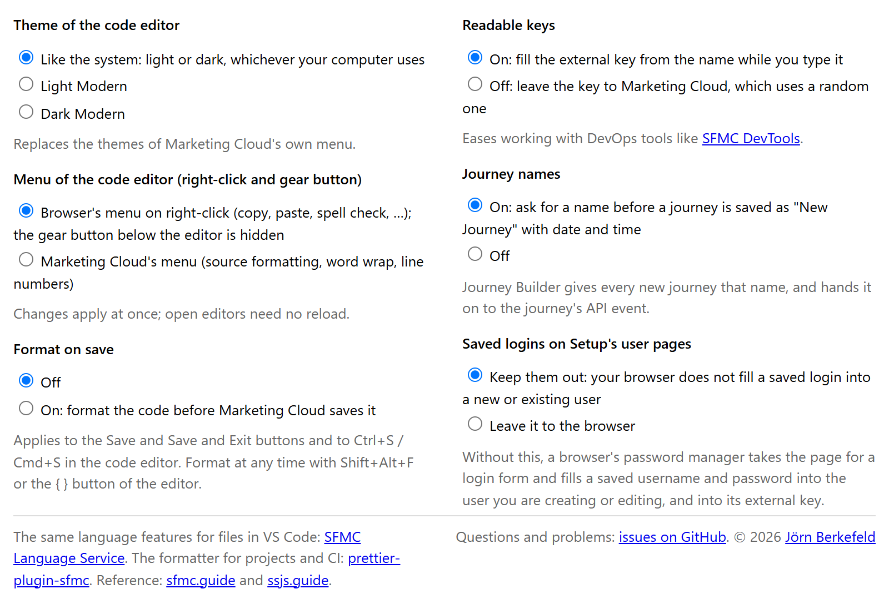

Click the extension's icon in Chrome's toolbar. Every change applies at once; no reload is needed.

- **Theme of the code editor**: like your computer (default), Light Modern or Dark Modern.
- **Right-click menu**: your browser's menu (default) or Marketing Cloud's.
- **Format on save**: off (default) or on.
- **Readable keys**: on (default) or off.
- **Journey names**: ask for a real name before a new journey is saved, on (default) or off.
- **Saved logins on Setup's user pages**: keep the browser's saved logins out of a new or existing user (default), or leave it to the browser.

The same options are on the extension's page in `chrome://extensions` (SFMC UX Tools → Details → Extension options).

## Where it comes from, and what goes with it

The editor features are not written for this extension alone. They are the same building blocks as in the tools for working on Marketing Cloud code outside the browser, so both sides behave alike:

| Tool                                                                                                                                                                                     | What it is                                                                                            | How this extension relates to it                                                                                                                                                                                                                                                          |
| ---------------------------------------------------------------------------------------------------------------------------------------------------------------------------------------- | ----------------------------------------------------------------------------------------------------- | ----------------------------------------------------------------------------------------------------------------------------------------------------------------------------------------------------------------------------------------------------------------------------------------- |
| [SFMC Language Service for VS Code](https://marketplace.visualstudio.com/items?itemName=joernberkefeld.sfmc-language) ([source](https://github.com/JoernBerkefeld/vscode-sfmc-language)) | AMPscript and SSJS support in VS Code: completions, hovers, diagnostics, formatting                   | The model for this extension. Both use the [sfmc-language-lsp](https://github.com/JoernBerkefeld/sfmc-language-lsp) language service, so completions, hovers, parameter help and diagnostics show the same texts and rules. The editor themes are VS Code's Light Modern and Dark Modern. |
| [prettier-plugin-sfmc](https://www.npmjs.com/package/prettier-plugin-sfmc) ([source](https://github.com/JoernBerkefeld/prettier-plugin-sfmc))                                            | Prettier plugin for AMPscript, SSJS, Marketing Cloud HTML and SQL                                     | Built into this extension; it does the formatting behind the **{ }** button, with the same settings as the VS Code extension. Use it directly to format files in a project or in CI.                                                                                                      |
| [sfmc.guide](https://sfmc.guide)                                                                                                                                                         | Reference for Marketing Cloud Engagement and Marketing Cloud Next, including every AMPscript function | The hover boxes for AMPscript link to its function pages.                                                                                                                                                                                                                                 |
| [ssjs.guide](https://ssjs.guide)                                                                                                                                                         | Reference for server-side JavaScript in Marketing Cloud, verified against the live platform           | The source of the SSJS descriptions and of the notes on what really works; the hover boxes for SSJS link to its pages.                                                                                                                                                                    |

If you write Marketing Cloud code in files, for example with [mcdev](https://github.com/Accenture/sfmc-devtools), the VS Code extension and the Prettier plugin give you there what this extension gives you in the browser.

## Installation

### Chrome Web Store

Not listed yet.

### From source (unpacked)

1. Clone this repository.
2. Open `chrome://extensions` and switch on **Developer mode**.
3. Run `npm install` and `npm run build`.
4. Choose **Load unpacked** and pick the `dist/extension` folder.

This works the same way in other Chromium browsers such as Edge.

## Privacy

The extension runs on eight places of Marketing Cloud Engagement and on one of Marketing Cloud Next:

- the Installed Packages page (`https://*.exacttarget.com/Content/Administration/InstalledPackages.aspx`), where it reads the open dialog to find the scope checkboxes and clicks them on your request;
- Content Builder (`https://content-builder.<stack>.marketingcloudapps.com`), where it adds colours, completions, hovers, parameter help, error underlines and formatting to the code editor. The editor reads your code through the colouring rules, and the built-in language service and formatter read it to do the rest; all of this happens inside the page only. In the dialog that saves a new content block it reads the name you type and writes the key derived from it into the key field, and it adds such a key to the request that Content Builder sends when a new email is saved. Before it uses a key there, it asks Content Builder's own server, the one the page is talking to anyway, whether that key is free. To tell a code resource of CloudPages from other content, the extension reads the asset type, and nothing else, from the message with which Marketing Cloud sets the editor up. The part that understands the types of server-side JavaScript is large, so the extension only adds it to a Content Builder page that shows a code editor; for this it has Chrome's `scripting` permission, which it uses for nothing but loading that one file of its own into such a page. No code is ever loaded from anywhere else. Chrome's site-access prompt names `marketingcloudapps.com` as a whole because the stack number in the address differs per account; the extension itself is restricted to the addresses listed here.
- Automation Studio (`https://mc.<stack>.marketingcloudapps.com/AutomationStudioFuel3/`), where it adds colours, completions, hovers, parameter help, error underlines and quick fixes and formatting to the code editor of the script activity and applies the editor theme. The editor reads your script through the colouring rules and the built-in language service reads it to do the rest, inside the page only; the large TypeScript part is added to such a page in the same way as on Content Builder. The code editor of the SQL query activity gets the editor theme and formatting only; the built-in formatter reads the query inside the page. The same files as on Content Builder are loaded there, but the code editors of all other activities are left as they are. In the dialogs that create an activity and on the page of a new automation, it reads the name you type and writes the key derived from it into the dialog's key field.
- Contact Builder (`https://mc.<stack>.marketingcloudapps.com/contactsmeta/`), where it does the same in the dialog that creates a data extension, and nothing else.
- Email Studio (`https://*.exacttarget.com/C12/Default.aspx`), where it also does only that, in the dialog that creates a data extension, and on the page that creates a triggered send (`https://*.exacttarget.com/Content/Interactions/TriggeredSendConfiguration.aspx`). Chrome asks you to accept the wider site access when the extension is updated.
- Setup (`https://*.exacttarget.com/Content/Administration/SendManagement/`), where it does the same on the pages for a new sender profile, send classification, delivery profile or file location, and on the pages for a new role (`…/Roles/RoleDetails.aspx`) and a new user (`…/EmployeeDetails.aspx`).
- Journey Builder (`https://jbinteractions.<stack>.marketingcloudapps.com`), where it reads the name of the journey and of its API event, changes the key in the request that Journey Builder sends when a new journey or API event is saved, and holds a save back while the journey has its made-up name. Before it uses a key, it asks Journey Builder's own server, the one the page is talking to anyway, whether that key is free.
- the Marketing Cloud page around the apps (`https://mc.<stack>.exacttarget.com/cloud/`), where it adds the entry **Transactional Messages** to the Mobile Studio menu. It makes no requests until you open the panel of that entry. When you open it, it asks Marketing Cloud's own server, through the page you are logged in to, for the list of transactional SMS, push and OTT messages, and for the details of the one you click. It shows them to you and keeps nothing. When you open the form for a new message, it asks the same server for the SMS codes and keywords, or the push apps and the names and keys of the mobile messages in Content Builder with what each was written for, of the business unit, to offer them in the form. When you send that form, it sends the new message, or what you changed of an existing one, to that server, and when you delete a message and confirm it, it sends that one delete request. Before a change or a delete it reads the message again, and after a change once more. On this page the extension always adds its colour stylesheets and a small script that reads the editor theme you chose on the options page and marks the page with that theme, or with the light or dark mode of your system as long as you chose none; this happens whether you open the panel or not. The page loads one file of the extension, its icon. Only when you open the form of an SMS message does the extension load four more of its own files into that page, the code editor for the text of the message with its colours and language features; they read that text inside the page only, and no code is loaded from anywhere else.
- the content editor of Marketing Cloud Next (`https://<your domain>.lightning.force.com/cmsAuthor/contentEditor.app`), where it adds explanations, parameter help, error underlines with quick fixes and formatting on **Shift+Alt+F** to the code editor of an HTML email and of the HTML component. The built-in language service and formatter read your code to do this, inside the page only. It makes no requests there and changes nothing but the code you format. The page loads one file of the extension, its icon, which marks the extension's boxes; the same goes for Content Builder and Automation Studio. Chrome's site-access prompt names `lightning.force.com` as a whole because the first part of the address differs per account; the extension itself is restricted to the address of the content editor.

The questions about a free key in Journey Builder and Content Builder, the lists and details of transactional messages with the lists their form offers, a new or changed transactional message that you sent and the delete of one that you confirmed, are the only requests the extension ever makes. They go to Marketing Cloud's own servers and nowhere else.

It does not collect any data and sends nothing to anyone but Marketing Cloud itself: apart from the requests described above, it makes no network requests. The only thing it stores is your choice on the options page, in Chrome's extension storage (synced with your Chrome profile if sync is on).

## Development

```bash
npm install
npm run lint
npm test
npm run build
```

- `src/` holds the extension's sources. `npm run build` writes the loadable extension to `dist/extension` and packs that folder as `dist/chrome-sfmc-ux-tools-v<version>.zip` for the Chrome Web Store. For **Load unpacked**, always pick `dist/extension`, not `src`.
- The build bundles `src/editor-format.js` with Prettier and `prettier-plugin-sfmc`, and `src/editor-language.js`, the files in `src/editor-language` and the `sfmc-language-lsp` package (currently 4.6.0) into one classic script each with esbuild. A third bundle, `src/editor-typescript.js`, holds TypeScript (6.0.3, the exact version the service is built for), the SSJS service of `sfmc-language-lsp/typescript` and the text of `ssjs-data`'s `sfmc-globals.d.ts`; it alone is minified. The build fails if a bundle calls `eval` or `new Function`, which Chrome does not allow. A fourth bundle, `src/editor-codemirror.js`, holds CodeMirror 5 with its HTML mode and hint addon, and `src/editor-codemirror.css` becomes CodeMirror's stylesheet: the code editor for the text of a transactional SMS, the only place where the extension brings an editor instead of working on the page's own. `src/transactional-messages.js` loads that bundle, `language-data.js`, `editor-highlight.js` and `editor-language.js` with `import()` into its own (isolated) world when an SMS form opens, which is why the manifest lists them as web accessible for `exacttarget.com`. All other files are copied as they are.
- `src/editor-language/core` holds the editor-independent logic (text and a position in, plain data out), and the files next to it bind it to CodeMirror.
- The TypeScript bundle is about 4 MB, so it is not a content script. When the language script sets up its first editor in a frame, it dispatches `sfmc-ux-tools:need-typescript` on the document; `src/editor-typescript-loader.js` (extension world) passes that on, and the service worker `src/background.js` injects `editor-typescript.js` into the page world of the document that asked with `chrome.scripting.executeScript` and answers whether that worked; after a failure the next editor that is set up asks again. TypeScript's diagnostics only run in the check after typing has paused. The language script looks the TypeScript API up at every use and falls back to the catalogue without it.
- `node scripts/measure-typescript.mjs` (after a build) prints the size of the TypeScript bundle and how long it takes to start and to answer for a 1,500-line document.
- `npm test` runs the build first, because the completion tests run the built bundle.
- `npm run icons` redraws the icons in `src/icons/`.
- **The pictures in this README** come from demo pages in `demo/`, not from Marketing Cloud: they load the built extension and show made-up content only (`Demo App`, `Jane Doe`, the code `00000`, …). `npm run screenshots` builds the extension and writes them again to `images/`, using the Edge installed on Windows without opening a window; set `SCREENSHOT_BROWSER` to the path of another Chromium browser to use that one. `node scripts/screenshots.js hover format` takes only the named pictures. The run fails if a feature is not on screen or if a page tries to reach anything but the local demo server. `puppeteer-core` drives the browser and `gifenc` writes the animations; both are only used for this.
- `npm run generate` rewrites `src/language-data.js` from the `ampscript-data` and `ssjs-data` packages; run it after updating either dependency. A test fails if the file is out of date.
- In `package.json`, `dependencies` are the packages whose code or data ends up in the shipped extension; `devDependencies` are tools for building, linting and testing. The package is never installed from npm, so the split is for clarity only.
- `codemirror` is fixed to the exact version Content Builder ships (5.65.21), so that the tests run against the editor the extension meets in the page. Change it only when Marketing Cloud updates its editor. The same version is bundled for the code editor of a transactional SMS, so it is listed under `dependencies`.
- `ace-builds` is fixed to the exact version of the Ace editor in Automation Studio's script activity (1.4.12), for the same reason. It is only used by the tests: `src/editor-language/ace` builds its mode at run time from the Ace of the page and bundles no copy of it.
- Keep `version` in `package.json` and `src/manifest.json` identical; a test checks this.
- `npm run verify:bundled-latest` compares the SFMC packages in `package-lock.json` (`sfmc-language-lsp`, `prettier-plugin-sfmc`, the data packages and what they bring along) with the newest versions on npm and fails if one is behind. The release workflow runs it before building, because the build inlines these packages. Update them with `npm install <package>@latest`.

### Releasing

Publishing a GitHub Release runs `.github/workflows/chrome-webstore-publish.yml`:

- The release tag must equal the version in `src/manifest.json` (a leading `v` is allowed), otherwise the run fails.
- The run lints, tests and builds, and attaches the zip to the release.
- For a regular release it then uploads the zip to the Chrome Web Store and submits it for publication. Google reviews every version; it goes live when the review passes. Prereleases are not uploaded.
- The upload is skipped while any of the repository secrets below is missing.

One-time setup at Google, before the first automatic upload:

1. Register a [Chrome Web Store developer account](https://chrome.google.com/webstore/devconsole) (one-time fee) and switch on 2-step verification for the Google account; the store requires it for publishing.
2. Upload the first version by hand in the developer dashboard and fill in the store listing and the privacy tab. The API cannot create an item or fill in the listing. Publish it once with the visibility it should keep, because later uploads reuse that visibility.
3. Note the **publisher ID** (dashboard, Account) and the **extension ID** (the item's page).
4. In a Google Cloud project, enable the **Chrome Web Store API** and create OAuth credentials. The [chrome-webstore-upload-keys](https://github.com/fregante/chrome-webstore-upload-keys) guide walks through this and yields the client ID, the client secret and a refresh token.
5. Set the OAuth consent screen to **In production**. While it is in "Testing", Google lets refresh tokens expire after 7 days, and the uploads would start failing.
6. Store the values as repository secrets: `CWS_PUBLISHER_ID`, `CWS_EXTENSION_ID`, `CWS_CLIENT_ID`, `CWS_CLIENT_SECRET` and `CWS_REFRESH_TOKEN`.

## License

[MIT](LICENSE) © Jörn Berkefeld
